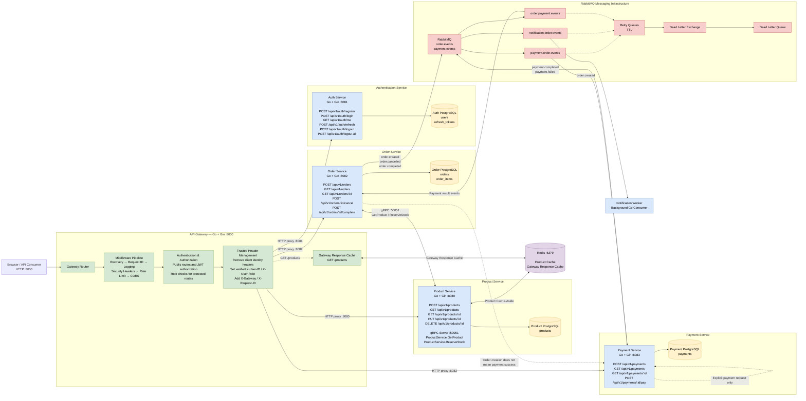
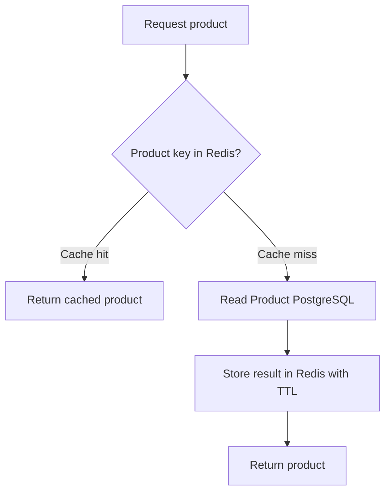
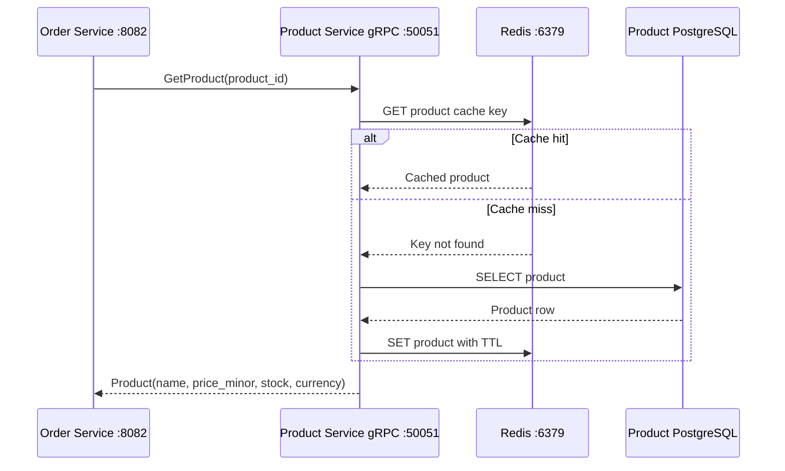
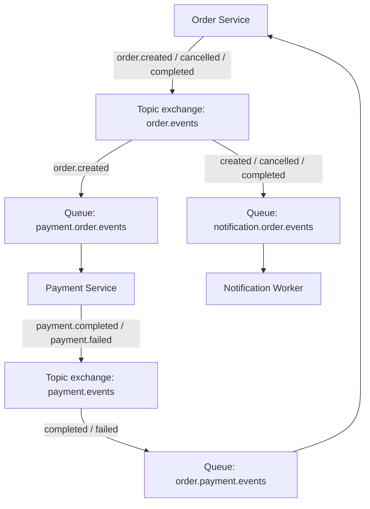
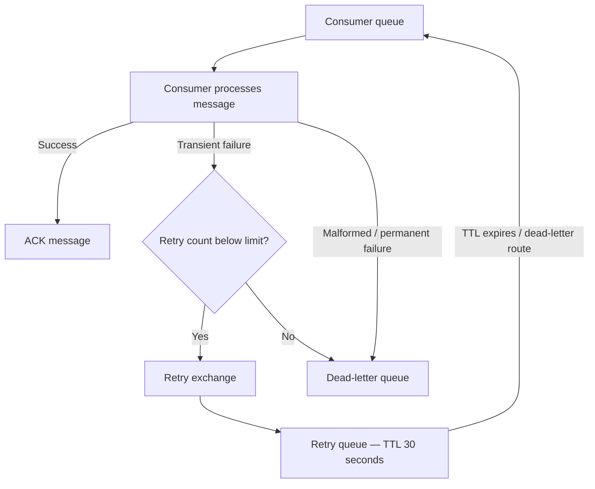
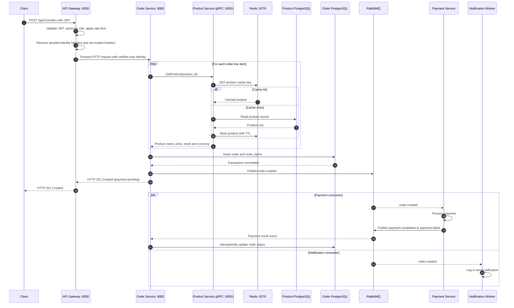

# Distributed Services Architecture

A documentation-first overview of the distributed backend: API gateway, independent Go services, PostgreSQL databases, Redis caching, synchronous gRPC communication, asynchronous RabbitMQ messaging, retries, dead-letter queues, and the order/payment lifecycle.

> **Architecture scope:** This document describes the architecture currently outlined for the project. It distinguishes implemented behavior from production-hardening recommendations where relevant.

---

## Table of contents

1. [System overview](#1-system-overview)
2. [Services and responsibilities](#2-services-and-responsibilities)
3. [API gateway](#3-api-gateway)
4. [Databases and data ownership](#4-databases-and-data-ownership)
5. [Caching with Redis](#5-caching-with-redis)
6. [Synchronous communication with gRPC](#6-synchronous-communication-with-grpc)
7. [Asynchronous communication with RabbitMQ](#7-asynchronous-communication-with-rabbitmq)
8. [Retry, TTL and dead-letter handling](#8-retry-ttl-and-dead-letter-handling)
9. [End-to-end order lifecycle](#9-end-to-end-order-lifecycle)
10. [Ports and protocols](#10-ports-and-protocols)
11. [Security and reliability considerations](#11-security-and-reliability-considerations)
12. [Suggested production improvements](#12-suggested-production-improvements)

---

## 1. System overview

The API Gateway is the single public entry point. Client requests arrive over HTTP and are routed to the appropriate backend service. Each service owns its own data store. Services communicate synchronously through gRPC when an immediate response is required, and asynchronously through RabbitMQ when work can proceed through events.

### High-level communication rules

- **Client → Gateway:** HTTP.
- **Gateway → services:** HTTP reverse proxy.
- **Order → Product:** synchronous gRPC.
- **Order / Payment / Notification:** asynchronous RabbitMQ events.
- **Service → database:** each service accesses its own PostgreSQL database.
- **Product Service and Gateway → Redis:** cache operations.
- No direct service-to-service HTTP call is part of the described internal communication design.

---

## 2. Services and responsibilities

### API Gateway — `:8000`

The gateway is the public entry point. It applies shared middleware, validates access tokens for protected routes, performs role checks, adds trusted identity headers, and proxies requests to backend services.

### Auth Service — `:8081`

Responsible for identity and authentication:

- `POST /register`
- `POST /login`
- `POST /refresh`
- `POST /logout`
- Owns user and refresh-token records.
- Uses password hashing and token issuance/refresh logic.

### Product Service — HTTP `:8080`, gRPC `:50051`

Responsible for the product catalogue:

- `GET /products`
- `GET /products/:id`
- `POST /products`
- `PUT /products/:id`
- `DELETE /products/:id`
- Exposes `ProductService.GetProduct()` over gRPC for internal product lookups.
- Owns product records and its product cache.

### Order Service — `:8082`

Responsible for order creation and lifecycle:

- `POST /orders`
- `GET /orders`
- `GET /orders/:id`
- `PATCH /orders/:id/cancel`
- `PATCH /orders/:id/complete`
- Reads the verified user identity forwarded by the gateway.
- Calls Product Service over gRPC to retrieve product details.
- Persists orders and order items.
- Publishes order events.
- Consumes payment result events and updates order status.

### Payment Service — `:8083`

Responsible for payment operations:

- `GET /payments`
- `GET /payments/:id`
- `POST /payments/:id/pay`
- Consumes `order.created`.
- Executes the configured payment operation (currently represented by a simulated gateway in the described flow).
- Persists payment data.
- Publishes `payment.completed` or `payment.failed`.

### Notification Worker — no public HTTP port

A background consumer, not a client-facing API service:

- Consumes `order.created`, `order.cancelled`, and `order.completed`.
- Currently logs the event.
- Can later integrate email, SMS, or other notification providers.

---

## 3. API gateway

### Middleware pipeline

The gateway applies common middleware to incoming routes:

1. **Recovery:** catches panics so a handler panic does not crash the whole gateway process.
2. **Request ID:** assigns or propagates a request correlation identifier.
3. **Logging:** records request metadata and outcome.
4. **Security headers:** adds defensive HTTP response headers.
5. **Rate limiting:** restricts excessive request rates.
6. **CORS:** permits the configured frontend origins, including `localhost:3000` and `localhost:5173`.

### Public and protected routes

| Route | Access rule |
|---|---|
| `/health` | Public |
| `/api/v1/auth/**` | Public at gateway; Auth Service handles authentication |
| `GET /api/v1/products` | Any authenticated role |
| `POST /api/v1/products` | Admin only |
| `PUT /api/v1/products/**` | Admin only |
| `/api/v1/orders/**` | Any authenticated role |
| `/api/v1/payments/**` | Any authenticated role |

The exact route matching and allowed HTTP methods should be kept consistent between gateway and service routers.

### Trusted identity headers

For protected requests, the gateway should:

1. Remove client-supplied `X-User-ID`, `X-User-Role`, and `X-Gateway` headers.
2. Validate the JWT.
3. Apply authorization / role checks.
4. Set `X-User-ID` and `X-User-Role` from verified JWT claims.
5. Add `X-Gateway: api-gateway` and `X-Request-ID`.
6. Proxy the request to the target service.

**Trust boundary:** backend services must not be directly exposed to untrusted clients. Network policy/firewall rules should restrict service ports to the gateway and approved internal callers. Otherwise, a caller might bypass gateway authentication and forge identity headers.

---

## 4. Databases and data ownership

Each service owns its own PostgreSQL data. This is the database-per-service pattern.

| Service | Database contents |
|---|---|
| Auth Service | `users`, `refresh_tokens` |
| Product Service | `products` |
| Order Service | `orders`, `order_items` |
| Payment Service | `payments` |

### Why separate databases?

- A service can change its schema without coordinating every other service.
- Each service controls its own migrations and persistence logic.
- A failure or heavy query load in one service is less likely to directly affect another service's database.
- Services communicate through APIs/events rather than querying another service's tables.

### Important data ownership rule

Do not create cross-service SQL foreign keys. For example, `orders` can store a `user_id` and product identifiers as references, but it should not depend on a PostgreSQL foreign key into the Auth or Product database. Validate external references through service communication and store the required order-time product snapshot (such as product name, unit price and currency).

---

## 5. Caching with Redis

Redis is used for two distinct cache responsibilities in this design.

### A. Product Service cache

The Product Service uses a cache-aside pattern:

- **Hit:** return the cached value.
- **Miss:** read PostgreSQL, populate Redis, then return the value.
- **TTL:** limits how long an entry remains valid.
- **Invalidation:** product create/update/delete operations must invalidate or refresh affected keys.

### B. Gateway response cache

The gateway caches eligible `GET /products` responses. This can avoid repeatedly proxying identical catalogue requests to Product Service.

These are separate cache layers even if they use the same Redis server. Use distinct key prefixes/namespaces, for example:

- `product:...` for Product Service data.
- `gateway:products:...` for gateway HTTP responses.

### Cache correctness

- Do not cache authenticated or user-specific responses under a key that ignores user identity or authorization scope.
- Do not cache errors as successful product responses.
- Invalidate affected keys after writes.
- Choose TTLs based on how quickly product data must become visible.
- Treat Redis as a performance layer, not the source of truth. PostgreSQL remains authoritative.

---

## 6. Synchronous communication with gRPC

The Order Service calls the Product Service's gRPC server when it needs authoritative product details for each order line item.

### Contract

The `product.v1.ProductService` protobuf contract defines the service and request/response messages. The key operation is:

- Request: product identifier.
- Response: product name, price in minor currency units, stock, and currency.

### Why gRPC here?

- The Order Service needs a direct answer before it can safely construct the order.
- Protobuf provides a strongly typed service contract.
- gRPC uses HTTP/2 and efficient binary serialization.
- A timeout bounds how long the order request waits for the Product Service.

The described client uses an insecure local connection and a short timeout. For deployment across untrusted networks, use TLS or service-mesh mTLS, explicit deadlines, and bounded retries where safe.

### Failure behavior

If Product Service is unavailable or the product cannot be found, Order Service should fail order validation rather than silently inventing product details. Validate stock and price according to the business rules, and store an order-time price snapshot.

---

## 7. Asynchronous communication with RabbitMQ

RabbitMQ decouples order processing, payment processing, and notifications. Producers publish events to topic exchanges. Consumer queues bind to the routing keys they need.

### Exchanges and routing keys

| Exchange | Type | Published routing keys |
|---|---|---|
| `order.events` | Topic, durable | `order.created`, `order.cancelled`, `order.completed` |
| `payment.events` | Topic, durable | `payment.completed`, `payment.failed` |

### Queue bindings

| Queue | Binding keys | Consumer |
|---|---|---|
| `payment.order.events` | `order.created` | Payment Service |
| `notification.order.events` | `order.created`, `order.cancelled`, `order.completed` | Notification Worker |
| `order.payment.events` | `payment.completed`, `payment.failed` | Order Service |

### Event flow

### What happens in each consumer?

**Payment Service**

1. Receives `order.created`.
2. Validates the event and relevant order/payment data.
3. Performs the payment operation.
4. Persists the payment result.
5. Publishes `payment.completed` or `payment.failed`.

**Order Service**

1. Receives a payment result event.
2. Identifies the corresponding order.
3. Applies an idempotent state transition.
4. Marks the order confirmed or handles the failed-payment state.

**Notification Worker**

1. Receives order lifecycle events independently.
2. Logs the event in the current implementation.
3. Can later send confirmation/cancellation/completion notifications.

### Why separate queues?

Each queue is an independent subscription. Payment processing and notification processing can consume the same `order.created` event independently. Acknowledgement or failure in one consumer does not consume the event from the other consumer's queue.

---

## 8. Retry, TTL and dead-letter handling

Each consumer should have its own retry path and dead-letter queue (DLQ). A retry for one consumer must not unintentionally trigger every subscriber of the shared business-event exchange.

### Components

- **Consumer queue:** holds work for one consumer.
- **Retry exchange:** routes failed messages to the retry queue.
- **Retry queue:** holds the message for a configured delay (30 seconds in the described setup).
- **TTL:** causes the message to expire after the delay.
- **Dead-letter routing:** sends the expired retry message back to the intended original consumer queue.
- **DLQ:** stores messages that exceeded the retry limit or cannot be processed.

### Important implementation details

- Configure the retry queue's dead-letter exchange and routing key to return to the intended consumer queue.
- Keep retry and DLQ resources isolated per consumer.
- ACK only after processing and durable state changes succeed.
- Use bounded retries; avoid infinite poison-message loops.
- Record failure reason, event ID, retry count and timestamps.
- Provide a safe DLQ inspection and replay process.
- Ensure consumers are idempotent because RabbitMQ can redeliver messages.

---

## 9. End-to-end order lifecycle

This sequence shows the request path and the asynchronous work that continues after the HTTP response.

### Important response semantics

`HTTP 201 Created` means the order resource has been created. It does **not** mean payment has completed. The initial order status should communicate that payment is pending/processing. A later payment event updates the order's status.

### Reliability gap to address

If Order Service commits the order to PostgreSQL and then crashes before publishing `order.created`, the database contains the order but RabbitMQ never receives the event. The **transactional outbox pattern** addresses this by writing the order and an outbox event in the same database transaction; a publisher then reliably forwards the outbox event to RabbitMQ.

---

## 10. Ports and protocols

| Component | HTTP | gRPC | Messaging |
|---|---:|---:|---|
| API Gateway | `8000` | — | — |
| Auth Service | `8081` | — | — |
| Product Service | `8080` | `50051` | — |
| Order Service | `8082` | — | Publishes `order.events`; consumes `payment.events` |
| Payment Service | `8083` | — | Consumes `order.events`; publishes `payment.events` |
| Notification Worker | — | — | Consumes `order.events` |
| Redis | — | — | Redis protocol `6379` |
| RabbitMQ | Management/API ports depend on configuration | — | AMQP port commonly `5672`; management UI commonly `15672` |
| PostgreSQL | Database port commonly `5432` per instance | — | PostgreSQL protocol |

The RabbitMQ and PostgreSQL ports above are conventional defaults, not a claim about the actual host/container port mappings. Confirm the project's Compose or deployment configuration.

---

## 11. Security and reliability considerations

### Authentication and authorization

- Validate JWT signature, issuer, audience and expiration.
- Apply role checks at the gateway as described.
- Ensure services are reachable only from trusted internal networks.
- Never trust identity headers received directly from public clients.
- Consider service-to-service authentication in addition to network isolation.

### Messaging

- Use durable exchanges and queues.
- Use persistent messages and publisher confirms.
- Acknowledge messages only after successful processing.
- Use event IDs and idempotency keys.
- Handle duplicate, delayed and out-of-order events.
- Keep retry policies bounded and DLQs observable.

### Data and caching

- Keep each database owned by one service.
- Use migrations and backups.
- Treat PostgreSQL as the source of truth.
- Define cache TTL and invalidation rules.
- Do not allow a cache key to leak data across users or authorization scopes.

### Observability

Propagate `X-Request-ID` through HTTP requests and include correlation/event IDs in logs. For asynchronous flows, a message should carry a correlation ID so that the original request and later consumer activity can be traced together.

---

## 12. Suggested production improvements

These are recommended next steps; they should not be interpreted as already implemented unless the project contains them.

1. **Transactional outbox:** make database commits and event publication reliable.
2. **Idempotency:** prevent duplicate order/payment processing.
3. **OpenTelemetry:** distributed traces across gateway, gRPC and RabbitMQ consumers.
4. **Prometheus + Grafana:** metrics for latency, error rate, queue depth, retries, DLQ size, cache hit ratio and database health.
5. **Health/readiness probes:** distinguish process liveness from dependency readiness.
6. **TLS/mTLS:** encrypt and authenticate service-to-service traffic outside local development.
7. **Secrets management:** keep database credentials, JWT keys and broker credentials outside source control.
8. **Graceful shutdown:** stop accepting new requests, finish or safely requeue in-flight work, then close connections.
9. **Resilience controls:** deadlines, bounded retries, circuit breakers and concurrency limits.
10. **Deployment automation:** container images, Docker Compose for local integration, Kubernetes for orchestration, CI/CD and GitOps.

---

## Summary

This architecture combines three communication styles:

- **HTTP through the API Gateway** for client-facing requests.
- **gRPC** for the Order Service's synchronous Product Service lookup.
- **RabbitMQ topic exchanges and queues** for asynchronous order, payment and notification events.

Redis reduces repeated reads, while each PostgreSQL database remains the authoritative store for its owning service. Retry queues and DLQs improve message-processing resilience. The next major reliability milestone is the transactional outbox combined with idempotent consumers and distributed tracing.
